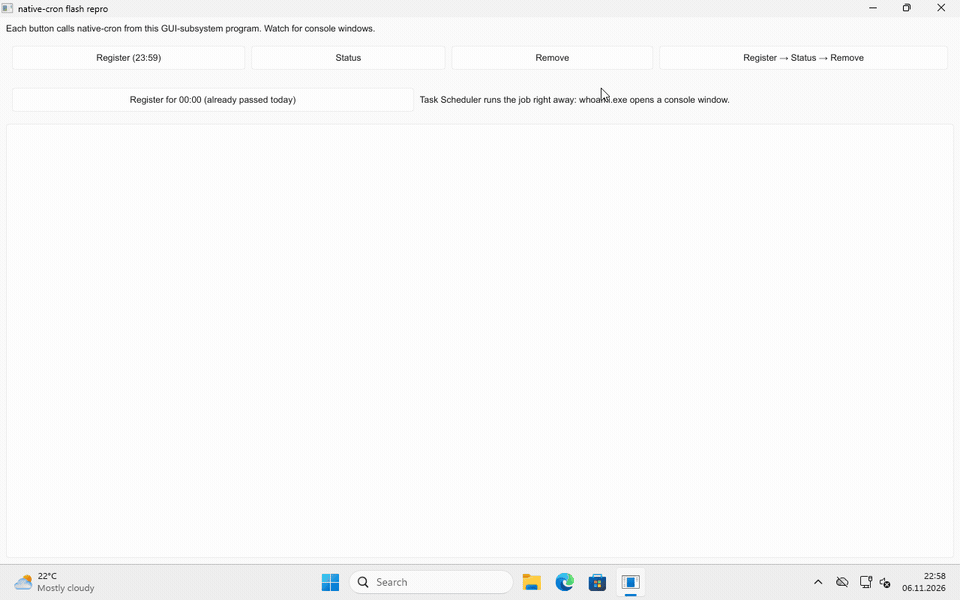
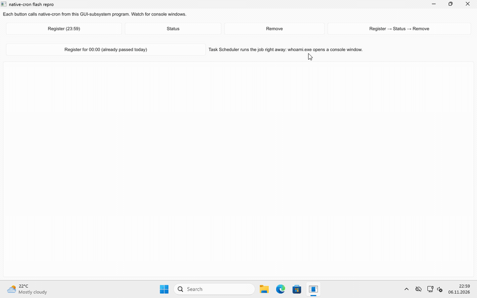
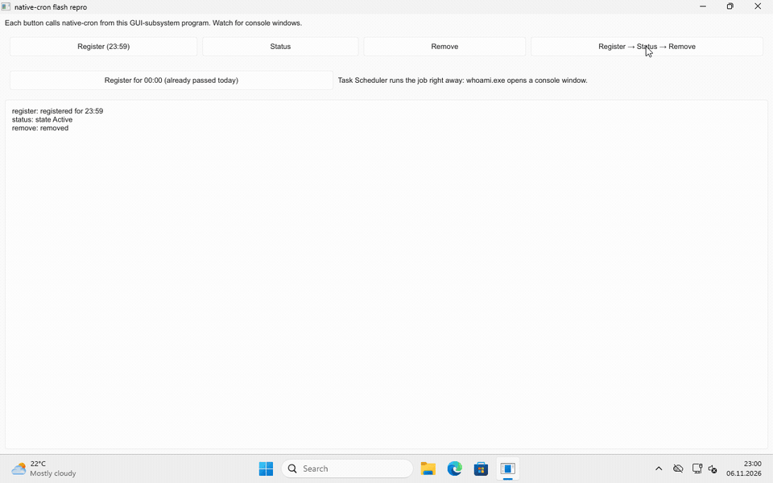

# native-cron-flash-repro

A minimal Windows GUI program (Rust + [Slint](https://slint.dev)) that calls
[native-cron](https://crates.io/crates/native-cron) and shows two things that
happen when a desktop app uses it on Windows:

1. **Every call flashes a console window.** native-cron starts `schtasks.exe`
   and `powershell.exe` without `CREATE_NO_WINDOW`. A GUI-subsystem program has
   no console those children could share, so Windows opens a new console for
   each one. On Windows 11 the `powershell.exe` behind `status()` even opens a
   full Windows Terminal window. Fixed by
   [The-Best-Codes/native-cron-rs#2](https://github.com/The-Best-Codes/native-cron-rs/pull/2).
2. **A job registered after its time of day runs at once.** The task's
   `StartBoundary` is today at the job's time. If that time has already
   passed, Task Scheduler treats today's run as missed and, because the task
   has `StartWhenAvailable`, starts it the moment it is registered.

## What the program does

| Button | Call |
|---|---|
| Register (23:59) | `register` a daily job at 23:59, so nothing runs right away |
| Status | `job_in(..).status()` |
| Remove | `remove_in(..)` |
| Register → Status → Remove | all three in a row |
| Register for 00:00 (already passed today) | `register` a daily job at 00:00 |

The job lives in the namespace `native-cron-flash-repro`, runs
`C:\Windows\System32\whoami.exe`, and is `visible` (InteractiveToken), so its
own console window shows when Task Scheduler starts it. "Remove" deletes it.
Each call runs on a worker thread; the results appear in the log below the
buttons.

## Recordings

Windows 11 Pro 25H2 (build 26200.8037), native-cron 0.2.0, Slint 1.18.1.
The GIFs play at half speed; the `.mp4` files next to them are real time.

**native-cron 0.2.0, Register → Status → Remove:** console windows for each call,
and a Windows Terminal window for `status()`.



**With #2 applied, the same three calls:** no window at all.



**With #2 applied, Register for 00:00:** the job starts as soon as it is
registered, so `whoami.exe` opens its console. Task Scheduler's history shows
event 107 ("launched instance") in the same second as event 106 (registered).
A job registered for 23:59 gets no event 107.



## Build

On Windows:

```sh
cargo build --release
```

From Linux with [cargo-xwin](https://github.com/rust-cross/cargo-xwin):

```sh
cargo xwin build --release --target x86_64-pc-windows-msvc
```

To build against #2 instead of the crates.io release, add:

```sh
--config 'patch.crates-io.native-cron.git="https://github.com/Bl4ckspell7/native-cron-rs"' \
--config 'patch.crates-io.native-cron.rev="a3123ea47f1f67cb5904532d18867d72e0d3aaca"'
```

`.cargo/config.toml` links the C runtime statically, so the `.exe` starts on a
clean Windows without the Visual C++ Redistributable.

## License

MIT
